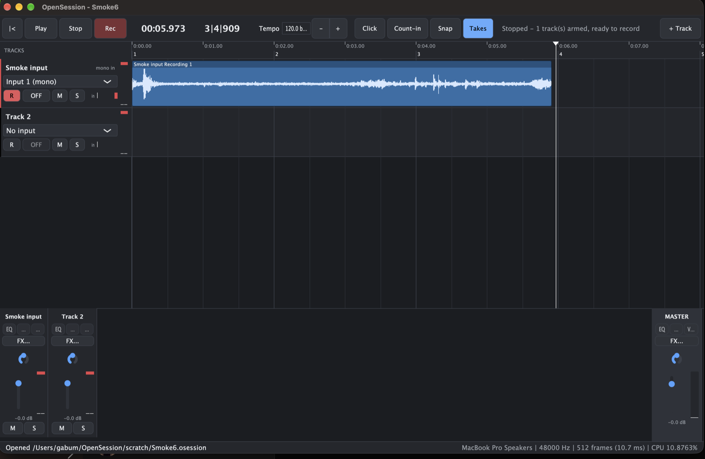

# OpenSession

A recording-first, open-source multitrack DAW for musicians who record live instruments and vocals. Native macOS app (C++20) on [Tracktion Engine](https://github.com/Tracktion/tracktion_engine) and [JUCE](https://github.com/juce-framework/JUCE). GPL-3.0-or-later.

**The workflow it is built around:** select audio-interface inputs → arm tracks → record → overdub → audition takes → edit non-destructively → mix → save/reopen → export a stereo mix and aligned stems.



## What works today (verified, see `docs/test-results.md`)
- Real input to a durable 24-bit / 48 kHz WAV inside the session folder, with the live input meter, explicit OFF / AUTO / ON monitoring per input, click and one-bar count-in.
- Several inputs recorded at once to independent files; overdubs against existing tracks with the playback and click kept out of the dry capture; latency compensated from driver figures with a loopback calibrator for the residual.
- Takes: re-recording over a region keeps every pass; the newest plays, older ones sit muted in a take lane; double-click to audition.
- Non-destructive split, trim, move, duplicate, delete, fades, clip gain, undo/redo. Source files are never modified.
- Mixer with gain, pan, mute, solo, meters, built-in EQ / compressor / reverb, master.
- Session = a folder (`Song.osession/`) with relative paths, atomic saves, a previous snapshot, autosave recovery, collect-and-save, recovery of recordings orphaned or interrupted by a crash.
- Export: stereo mix and per-track stems with identical start and length, clipping reported, nothing normalised.
- A 35-case deterministic self-test suite runs the real engine with synthetic input (`--run-tests`), plus command-line hardware checks (`--smoke-record`, `--soak`, `--measure-latency`).

Tested platforms: macOS 27.0.1 (MacBook Pro) and macOS 26.6.2 (MacBook Air), Apple Silicon, built-in microphone; Debug and Release builds. No external interface, Windows or Linux has been tested yet; see "Limits".

## Build

Requires Xcode Command Line Tools, CMake ≥ 3.22 and Ninja (`brew install cmake ninja`).

```bash
git clone https://github.com/biggg-nasty/OpenSession.git && cd OpenSession
tools/bootstrap.sh              # fetches pinned Tracktion Engine + JUCE over HTTPS, configures build/
cmake --build build -j
open build/OpenSession_artefacts/Debug/OpenSession.app
```

Release build: `tools/bootstrap.sh Release && cmake --build build-release -j`.

Demo machine prep (Release build, tests, fresh demo session, export check, device report): `tools/demo-prep.sh`.

## Test

```bash
APP=build/OpenSession_artefacts/Debug/OpenSession.app/Contents/MacOS/OpenSession
$APP --run-tests                                   # deterministic suite (exit 0 = pass)
$APP --print-audio-settings                        # device, buffer, driver latency, record adjustment
$APP --smoke-record scratch/Smoke.osession 6       # record the real input for 6 s, save, report
$APP --soak scratch/Soak.osession 3 8              # 3 min: 8 playback tracks + live input, CPU/dropout report
$APP --make-demo demo/DemoSession.osession         # synthetic fallback demo session
$APP --export-mix demo/DemoSession.osession /tmp/mix.wav
```

## Documentation
- `docs/recording-behavior.md` — how Logic Pro, Pro Tools, Live and REAPER document each recording behaviour (with evidence status), what OpenSession does, and which test proves it.
- `docs/architecture.md` — what is reused from the engine and what is original.
- `docs/test-results.md` — automated and hardware results, measured limits, issues found.
- `docs/cost-and-competition.md` — dated prices, reach, savings, licensing.
- `docs/hardware-procedures.md` — manual procedures for checks that need an interface.
- `docs/demo-script.md`, `HANDOFF.md`.

## Limits (honest list)
- One input per track; stereo tracks use a 2-channel input pair.
- Whole-take audition only; no range comping, punch in/out or edit groups yet.
- Verified on one Mac with a 1-channel built-in mic: two simultaneous *hardware* inputs, headphone monitoring and loopback latency are verified in the deterministic suite and by procedure, not yet on an interface.
- No plugin hosting, automation, MIDI or virtual instruments yet (engine supports them; deferred until the recording core is proven with musicians).

## Licence
OpenSession is free software under the GNU GPL v3 or later. It combines Tracktion Engine (GPLv3) and JUCE (AGPLv3, via GPLv3 §13). See `LICENSE` and `THIRD_PARTY_NOTICES.md`. The demo session audio is synthesised by the app and carries the same licence.
